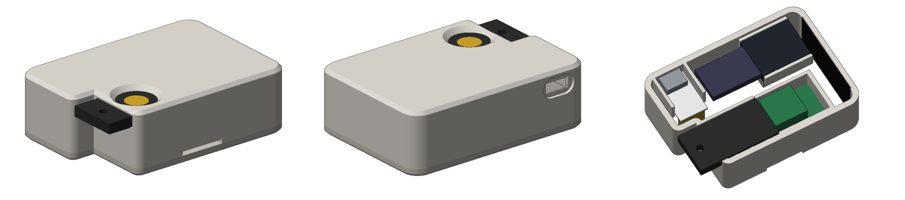

# KeyRelay

**Use your USB security key wirelessly.** KeyRelay puts a USB-A security key (tested with a
YubiKey 5 NFC) in a small box next to your keyboard and relays it over Bluetooth LE to a receiver
plugged into your computer. Touch the key on your desk; your computer can stay closed under the desk.



[日本語の README はこちら](docs/ja/README.md)

> **Status:** a working personal build, published as is. Tested on macOS with one YubiKey 5 NFC
> (firmware 5.1.2). Windows and Linux hosts are untested.
> Secure boot and flash encryption are not set up yet, so treat a unit like the key itself and read
> [SECURITY.md](SECURITY.md) before relying on it.

## What works

| Feature | How it is relayed | Status |
|---|---|---|
| FIDO2 / U2F (passkeys, WebAuthn) | 64-byte CTAPHID reports | Works: webauthn.io register + sign-in (Chrome) |
| OpenPGP (GnuPG) | CCID smart-card messages | Works: `gpg --card-status` |
| OTP typed on touch | keyboard reports, buffered per key press | Works: Yubico OTP validated on demo.yubico.com |
| PIV, OATH | CCID smart-card messages | Relayed; see the note on Yubico tools below |
| OTP challenge-response, slot configuration | HID feature reports, proxied one by one | Relayed; see the note on Yubico tools below |

Not yet confirmed: PIV/OpenPGP signing, PIV through standard PC/SC software (e.g. OpenSC), and
passkey management through Chrome's `chrome://settings/securityKeys`.

### ykman, Yubico Authenticator and KeePassXC

These tools only talk to USB devices that carry Yubico's USB vendor ID. KeyRelay uses its own USB
IDs and does not impersonate another vendor, so **these tools do not detect KeyRelay today**. That
affects OATH codes (Yubico Authenticator / ykman), PIV management (ykman) and OTP challenge-response
(KeePassXC). The plan is to get KeyRelay supported upstream once it has its own pid.codes PID:
- **ykman:** let it read device information over a PC/SC reader that is not named "Yubico YubiKey".
- **KeePassXC:** add KeyRelay's ID to its list of supported devices.

Browsers (FIDO), GnuPG and typed OTPs work as is.

## How it works

```
 computer ══USB══ receiver ─────── BLE ─────── desk unit ══USB══ security key
          (FIDO HID + CCID reader     (ESP32-S3,        (XIAO ESP32S3,
           + OTP keyboard)             native USB)       USB host)
```

- The **desk unit** (Seeed XIAO ESP32S3) is a USB host for the key. It claims the key's FIDO, CCID
  and OTP keyboard interfaces and forwards traffic without interpreting it (FIDO channel IDs are
  virtualised so channels survive re-enumeration).
- The **receiver** (any ESP32-S3 board with a native USB port) shows up as the same three interfaces
  and forwards everything to the desk unit.
- The BLE link uses LE Secure Connections plus an application-layer pre-shared key with AES-256-GCM.
  See [SECURITY.md](SECURITY.md) for what this does and does not protect.
- Both units are USB powered. The desk unit takes power (and its log console) through a CP2102N
  USB-UART module whose USB-C port sits at the back of the case.

## Building one

See **[docs/BUILD.md](docs/BUILD.md)** ([日本語](docs/ja/BUILD.md)) for the parts list, wiring,
firmware build, key provisioning and case assembly. Design notes and example logs (in Japanese, with the Japanese log setting) are in
[docs/ja/DEV_NOTES.md](docs/ja/DEV_NOTES.md). In short, from the repository root:

```sh
# ESP-IDF v5.4
(printf 'YDK1'; head -c 32 /dev/urandom) > keyrelay-key.bin   # same key for both units
idf.py -C firmware/receiver  set-target esp32s3 build merge-bin -o keyrelay_receiver_full.bin
idf.py -C firmware/desk_unit set-target esp32s3 build merge-bin -o keyrelay_desk_unit_full.bin
# flash each merged image at 0x0 and keyrelay-key.bin at 0x190000 (see docs/BUILD.md)
```

## Repository layout

```
firmware/
  components/yd_link/   BLE link, PSK encryption (yd_sec), fragmentation, CCID helpers
  desk_unit/            USB host side: FIDO, CCID and OTP relays (XIAO ESP32S3)
  receiver/             USB device side: FIDO HID, CCID, OTP keyboard drivers (TinyUSB)
  tests/host/           host-side unit tests (make -C firmware/tests/host)
hardware/
  case/                 parametric case (Python + manifold3d) and ready-to-print STLs
docs/                   build guide (English / Japanese), images
```

## Limitations and roadmap

- USB IDs: the default build uses the pid.codes **test** PID `0x1209:0x0001`, which is not unique.
  pid.codes does not allow devices with test PIDs to be redistributed, so no prebuilt firmware is
  published until KeyRelay has its own PID: build it yourself for your own use. A dedicated PID will be
  requested from pid.codes now that the project is public.
- Only the USB-A key variant has a case. A USB-C key variant and a battery-powered desk unit are planned.
- One request at a time per interface (same as the key itself). If the BLE link drops, the computer sees
  the smart card being removed, and PIN state is lost.
- Serial log messages are in English by default. Japanese can be selected in `idf.py menuconfig` →
  KeyRelay log language.
- Secure boot, flash encryption and NVS encryption are not set up by default. A draft guide is in
  [docs/HARDENING.md](docs/HARDENING.md) (untested).

## License

- Firmware, tools and documentation: [MIT](LICENSE)
- Hardware (case design files in `hardware/`): [CERN-OHL-P-2.0](hardware/LICENSE)

## Trademarks

KeyRelay is an independent project and is not affiliated with, endorsed by or sponsored by Yubico AB.
YubiKey and Yubico are trademarks of Yubico AB. Other product names are trademarks of their
respective owners and are used only to describe compatibility.
