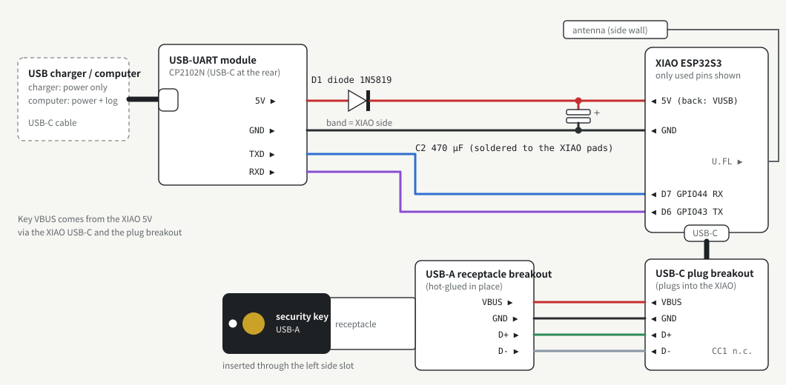

# Building KeyRelay (USB-A key, USB-powered)

[日本語版](ja/BUILD.md)

This guide builds the version that is in daily use: a desk unit for a **USB-A** security key,
powered over USB-C, and a receiver that plugs into the computer. Expect an afternoon of soldering
and a few test prints.

## 1. Parts

### Desk unit

| Part | Notes |
|---|---|
| Seeed Studio XIAO ESP32S3 + its U.FL antenna | USB host for the key. Do not forget the antenna. |
| USB-C **plug** breakout, 5 pins (VBUS, CC1, D+, D-, GND) | Plugs into the XIAO's USB-C and turns it into wires. |
| USB-A **receptacle** breakout, 4 pins (VBUS, D-, D+, GND) | The key plugs in here. |
| CP2102N USB-UART module with a USB-C port and a 5V pin (pins GND, TXD, RXD, 5V) | Power input and log console. Its USB-C is the only port on the case. |
| 1N5819 Schottky diode | Stops current flowing back into the charger/computer port. |
| 470 µF low-ESR polymer capacitor (e.g. OS-CON), ≥ 6.3 V | Absorbs the inrush when the key is plugged in and BLE TX peaks. |
| Thin stranded wire (red, black, green, white, blue, purple), heat-shrink tubing | |
| USB-A security key | Tested: YubiKey 5 NFC, firmware 5.1.2. |

### Receiver

| Part | Notes |
|---|---|
| ESP32-S3 dev board with **two** USB ports: native USB and UART ("COM") | Tested: Freenove ESP32-S3-WROOM. The native USB port goes to the computer. |

### Case and tools

- 3D-printed case: `hardware/case/stl/` (see section 7). PLA is fine.
- Soldering iron, flux, multimeter (continuity, resistance and diode modes), tweezers, hot glue.

The case dimensions in `hardware/case/case_usba_key.py` were measured on the parts used for the
first build. If your breakout boards differ, measure them and adjust the constants before printing.

## 2. Wiring



Ten wires plus a diode and a capacitor.

| # | From | To | Wire | Notes |
|---|---|---|---|---|
| **Power: USB-UART → XIAO** | | | | |
| 1 | USB-UART **5V** pin | D1 (1N5819), side **without** the band | — | Wrap the diode leg around the pin, solder, cover with heat-shrink. |
| 2 | D1, side **with** the band | XIAO **5V** (marked VUSB on the back) | red | |
| 3 | USB-UART **GND** | XIAO **GND** | black | |
| 4 | C2 470 µF | **+** to XIAO 5V, **−** to XIAO GND | — | Insert from the back so the can sits under the XIAO; leave the legs long and bend it flat. |
| **Log console: USB-UART ↔ XIAO** | | | | |
| 5 | USB-UART **TXD** | XIAO **D7** (GPIO44, RX) | blue | TX goes to RX. |
| 6 | USB-UART **RXD** | XIAO **D6** (GPIO43, TX) | purple | Swapped: nothing breaks, you just see no log. |
| **Key side: USB-C plug breakout → USB-A breakout** | | | | |
| 7 | plug **VBUS** | USB-A **VBUS** | red | Powers the key. |
| 8 | plug **GND** | USB-A **GND** | black | |
| 9 | plug **D+** | USB-A **D+** | green | The D+/D- order is reversed between the two boards: match by name. |
| 10 | plug **D-** | USB-A **D-** | white | Swapped: the key is not detected (nothing breaks). |
| — | plug **CC1** | — | — | Leave unconnected. |

Pin orders (check the silkscreen on your boards):

- CP2102N module: GND, TXD, RXD, 5V
- XIAO, viewed from the top (component side): right column from the top is 5V, GND, 3V3;
  D7 is the bottom of the right column, D6 the bottom of the left column. Mirrored when viewed from the back.
- USB-C plug breakout, left to right: VBUS, CC1, D+, D-, GND
- USB-A breakout, receptacle facing you, left to right: VBUS, D-, D+, GND

Why the extra parts:

- **D1:** the XIAO's 5V pin is tied directly to its own USB-C VBUS. The diode makes sure nothing can feed
  back into your charger or computer. It drops 0.2–0.3 V, so the key sees about 4.7 V (fine).
- **C2:** plugging in the key and BLE transmit bursts draw short current spikes; without the capacitor
  the XIAO can brown out and reboot.
- Total draw is about 0.2 A at peak, well within any USB port or charger.

### Checks before the first power-up (multimeter)

| Where | Mode | Expect |
|---|---|---|
| USB-UART 5V ↔ GND | resistance | not near 0 Ω |
| XIAO 5V ↔ GND | resistance | a value that keeps rising (the capacitor charging) |
| D1 (red probe on the USB-UART 5V side) | diode | about 180–400 |
| USB-UART GND ↔ XIAO GND | continuity | beep |
| TXD ↔ D7, RXD ↔ D6 | continuity | beep |
| neighbouring pins on the USB-A breakout | continuity | no beep |

## 3. Build the firmware

Install [ESP-IDF v5.4](https://docs.espressif.com/projects/esp-idf/en/v5.4/esp32s3/get-started/),
then, from the repository root (all commands in this guide are run from there):

```sh
idf.py -C firmware/receiver  set-target esp32s3 build merge-bin -o keyrelay_receiver_full.bin
idf.py -C firmware/desk_unit set-target esp32s3 build merge-bin -o keyrelay_desk_unit_full.bin
```

Outputs:

- `firmware/receiver/build/keyrelay_receiver_full.bin`, `firmware/desk_unit/build/keyrelay_desk_unit_full.bin`:
  merged images (bootloader + partition table + app) for the first install, flashed at `0x0`.
- `firmware/<project>/build/keyrelay_<project>.bin`: the app alone, flashed at `0x10000` for updates
  (section 9).

Options:

- **No keyboard on the receiver** (`CONFIG_YD_OTP_KEYBOARD`, on by default): if you do not use OTPs typed on
  touch, run `idf.py -C firmware/receiver menuconfig` → *KeyRelay* and turn it off, or add
  `CONFIG_YD_OTP_KEYBOARD=n` to `firmware/receiver/sdkconfig.defaults` before the first build. The receiver
  then shows up as FIDO + smart card only (see "Keystroke injection" in SECURITY.md).
- **Update over the serial console** (`YD_UART_DOWNLOAD_CMD` in `firmware/desk_unit/main/main.c`,
  **off** by default): set it to `1` before building to be able to reflash the desk unit without opening
  the case (section 9). Read the serial-console item in [SECURITY.md](../SECURITY.md) first.

## 4. Create the pairing key

Both units need the same random key. Without it, BLE does not start.

```sh
(printf 'YDK1'; head -c 32 /dev/urandom) > keyrelay-key.bin
```

Keep this file private and never commit it.

## 5. Flash

The commands below use `esptool.py` from ESP-IDF, run from the repository root where
`keyrelay-key.bin` was created. The browser tool [esptool-js](https://espressif.github.io/esptool-js/)
works too: add the merged image at `0x0` and the key at `0x190000` in one session.
**Do not use "Erase Flash" later**: it deletes the key. Writing a merged image at `0x0` also clears the
BLE pairing (the `nvs` partition); the units pair again on their own.

### Desk unit: before assembly

Flash the XIAO through its own USB-C port **before** the USB-C plug breakout goes in:

1. Attach the antenna to the U.FL connector (press straight down until it clicks).
2. Hold **B** (BOOT), plug the XIAO into the computer, release B.
3. Flash:
   ```sh
   esptool.py --chip esp32s3 -p PORT write_flash 0x0 firmware/desk_unit/build/keyrelay_desk_unit_full.bin 0x190000 keyrelay-key.bin
   ```
4. Press **R** (reset), unplug.

Later updates go through the same port, so the case has to be opened again, unless you enabled the
serial-console update (section 9).

### Receiver

Connect the **COM/UART** port (the dev board resets into the bootloader by itself):

```sh
esptool.py --chip esp32s3 -p PORT write_flash 0x0 firmware/receiver/build/keyrelay_receiver_full.bin 0x190000 keyrelay-key.bin
```

Then plug the **native USB** port into the computer for normal use. Keep the COM port unplugged in daily
use (see SECURITY.md).

## 6. First power-up

1. Plug the USB-C plug breakout into the XIAO and the key into the USB-A breakout.
2. Plug the receiver's native USB port into the computer.
3. Plug the desk unit's USB-C (the CP2102N) into the computer to see the log at 115200 baud, e.g.
   `screen /dev/cu.usbserial-XXXX 115200`. A plain charger works too once everything runs.

Within a few seconds the two units pair over BLE. The key's LED lights up and the desk unit's log
shows the key's interfaces being claimed (FIDO, CCID, OTP keyboard) and the BLE link coming up.
Log messages are in Japanese.

Then check, in this order:

1. **FIDO:** register and sign in on [webauthn.io](https://webauthn.io).
2. **Smart card:** `gpg --card-status` shows the key's serial number.
3. **OTP:** open a text field and touch the key: a 44-character OTP starting with `cccccc` is typed.

If the key's LED does not light up, check wires 7/8 and the diode. If it lights but is not detected,
D+ and D- are probably swapped. If there is no log, D6 and D7 are swapped.

## 7. Print and assemble the case

Files in `hardware/case/stl/`:

| File | Print |
|---|---|
| `keyrelay_usba_test_touch.stl` | First: checks the touch window and the USB-A breakout seat (≈ 15 min). |
| `keyrelay_usba_test_usbc_port.stl` | Checks the rear USB-C opening for the CP2102N. |
| `keyrelay_usba_body.stl` | Body, printed top face down (as exported). |
| `keyrelay_usba_cover.stl` | Bottom cover. |

To regenerate after changing dimensions: `pip install manifold3d trimesh numpy`, then
`python3 hardware/case/case_usba_key.py`.

Assembly order (looking into the open body from below):

1. **USB-A breakout:** with the key plugged in (gold touch disc facing the top of the case), seat the
   receptacle in the recess under the top plate. Secure the board edges with hot glue. Keep glue out of
   the receptacle and away from the pins. Route its wires through the gap in the rear stop.
2. **CP2102N:** USB-C facing the top plate. Tilt it, slide the USB-C end into the rear wall opening,
   then lower the pin end in front of the rear support.
3. **XIAO + plug breakout:** XIAO shield side up, between the rails. Hold it to the top plate with
   double-sided tape. Tape rather than glue makes later rework possible.
4. **Antenna:** stick it flat into the shallow pocket on the side wall, away from the key and the USB
   metal. Coil the spare cable loosely.
5. Close the cover, plug in USB-C, and repeat the checks from section 6.

## 8. Daily use notes

- **macOS "Keyboard Setup Assistant"** appears once because the receiver includes a keyboard. Close it.
- **Japanese input:** before typing an OTP, the receiver sends the 英数 (LANG2) key so the OTP is not
  converted by a Japanese IME. The input mode stays alphanumeric afterwards.
- **ykman, Yubico Authenticator and KeePassXC do not detect KeyRelay**: they only accept Yubico's USB
  IDs (see the README).
- **Only one application can hold the smart card at a time.** If gpg or another tool cannot connect,
  run `gpgconf --kill scdaemon` and try again.
- For GnuPG, `~/.gnupg/scdaemon.conf` with `disable-ccid` and `pcsc-shared` makes gpg use the macOS
  smart-card service and share the card with other tools.

## 9. Updating the desk unit

Flash only the app at `0x10000`. The key at `0x190000` and the BLE pairing stay.

**Default build (case opened):** unplug the USB-C plug breakout from the XIAO, hold **B**, connect the
XIAO's USB-C to the computer, release B, then:

```sh
esptool.py --chip esp32s3 -p PORT write_flash 0x10000 firmware/desk_unit/build/keyrelay_desk_unit.bin
```

The receiver is updated the same way through its COM port.

**With `YD_UART_DOWNLOAD_CMD 1` (case closed):**

1. Connect the desk unit's USB-C to the computer and open the console:
   `screen /dev/cu.usbserial-XXXX 115200`.
2. Type `keyrelay-download` and press Enter. The unit reboots and the log ends with
   `waiting for download`.
3. Quit screen (`Ctrl-A`, `K`, `y`). The port must be free for the flasher.
4. Flash the app:
   ```sh
   esptool.py --chip esp32s3 -p PORT -b 115200 --before no_reset write_flash 0x10000 firmware/desk_unit/build/keyrelay_desk_unit.bin
   ```
5. Unplug and replug the USB-C: the unit does not reset by itself (the module's DTR/RTS lines are not
   wired).

Notes for flashing through the CP2102N:

- **Stay at 115200 baud.** Faster rates over the module's jumper wires can corrupt the write. In
  esptool-js, set *Baudrate* to 115200 before pressing *Connect*.
- **Pick the CP2102N port** (`cu.usbserial-…`, "CP2102N USB to UART Bridge", vendor ID `0x10c4`).
  "USB JTAG/serial debug unit" (vendor ID `0x303a`) is the XIAO's own USB port, which only appears when
  the XIAO itself is connected.
- **If the unit boot-loops** with `invalid header` or `Invalid image block, can't boot`, the write was
  incomplete. Open the case and flash the merged image and the key through the XIAO's own USB-C, as in
  section 5. This also clears the BLE pairing; the units pair again on their own.

## 10. BOOT buttons and pairing a different unit

- **Receiver:** holding BOOT for 3 s clears its BLE bonds (as soon as 3 s have passed).
- **Desk unit:** holding BOOT for 3 s and releasing clears its bonds. A **short** press stops or restarts
  the key's USB bus. That resets the smart card, so PIV/OpenPGP PINs must be entered again. The desk
  unit's BOOT button is inside the case.
- A desk unit with no bond, or within 120 s of booting, accepts a new receiver. To pair a new receiver
  without opening the case, power-cycle the desk unit. Either way, both units must share the same
  pairing key.
