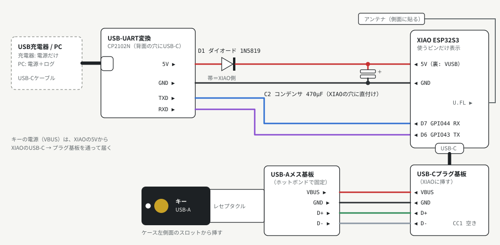

# KeyRelay の作り方（USB-A キー・USB 給電版）

[English](../BUILD.md)

作者が毎日使っている構成の作り方です。**USB-A** のセキュリティキー用の机上ユニット（USB-C 給電）と、
パソコンに挿すレシーバーを作ります。はんだ付けに半日、ケースの試し刷りが数回くらいです。

## 1. 部品

### 机上ユニット

| 部品 | メモ |
|---|---|
| Seeed Studio XIAO ESP32S3 と付属の U.FL アンテナ | キーの USB ホスト。アンテナを付け忘れると BLE がほとんど届かない |
| USB-C **プラグ**基板（5ピン: VBUS・CC1・D+・D-・GND） | XIAO の USB-C に挿して、線を取り出す |
| USB-A **メス**基板（4ピン: VBUS・D-・D+・GND） | キーを挿す口 |
| CP2102N の USB-UART 変換（USB-C 付き、5V ピンあり。ピン: GND・TXD・RXD・5V） | 電源とログの入口。ケースに出る口はこの USB-C だけ |
| ショットキーダイオード 1N5819 | 充電器・パソコンへの逆流防止 |
| 低 ESR の導電性高分子コンデンサ 470µF（OS-CON など）、6.3V 以上 | キーを挿した瞬間や BLE 送信時の突入電流を受け止める |
| 細いより線（赤・黒・緑・白・青・紫）、熱収縮チューブ | |
| USB-A のセキュリティキー | 確認済み: YubiKey 5 NFC（ファームウェア 5.1.2） |

### レシーバー

| 部品 | メモ |
|---|---|
| USB が**2つ**ある ESP32-S3 開発ボード（ネイティブ USB と UART「COM」） | 確認済み: Freenove ESP32-S3-WROOM。パソコンにはネイティブ USB 側を挿す |

### ケースと道具

- 3D プリントのケース: `hardware/case/stl/`（7章）。PLA で大丈夫です。
- はんだごて・フラックス・テスター（導通・抵抗・ダイオードモード）・ピンセット・ホットボンド

`hardware/case/case_usba_key.py` の寸法は、最初の1台に使った部品を実測したものです。
基板が違うときは測って、定数を直してから刷ってください。

## 2. 配線



電線10本と、ダイオード・コンデンサが1つずつです。

| # | から | へ | 線 | メモ |
|---|---|---|---|---|
| **電源（USB-UART 変換 → XIAO）** | | | | |
| 1 | USB-UART の **5V** ピン | D1（1N5819）の帯の**ない**側 | — | ダイオードの足をピンに巻いてはんだ付けし、熱収縮で覆う |
| 2 | D1 の帯の**ある**側 | XIAO の **5V**（裏の印字は VUSB） | 赤 | |
| 3 | USB-UART の **GND** | XIAO の **GND** | 黒 | |
| 4 | C2 470µF | **＋**を XIAO の 5V、**－**を GND | — | 裏から差して缶を XIAO の下に。足は長めに残して、曲げて寝かせる |
| **ログ（USB-UART 変換 ↔ XIAO）** | | | | |
| 5 | USB-UART の **TXD** | XIAO の **D7**（GPIO44・RX） | 青 | 送信 → 受信 |
| 6 | USB-UART の **RXD** | XIAO の **D6**（GPIO43・TX） | 紫 | 逆でも壊れないが、ログが出ない |
| **キー側（USB-C プラグ基板 → USB-A 基板）** | | | | |
| 7 | プラグ基板の **VBUS** | USB-A 基板の **VBUS** | 赤 | キーの電源 |
| 8 | プラグ基板の **GND** | USB-A 基板の **GND** | 黒 | |
| 9 | プラグ基板の **D+** | USB-A 基板の **D+** | 緑 | D+ と D- の並びが基板どうしで逆。名前で合わせる |
| 10 | プラグ基板の **D-** | USB-A 基板の **D-** | 白 | 入れ違えるとキーが認識されない（壊れはしない） |
| — | プラグ基板の **CC1** | — | — | つながない |

ピンの並び（基板の印字で確かめてください）:

- CP2102N: GND・TXD・RXD・5V
- XIAO（表＝部品のある面から見て）: 右列の上から 5V・GND・3V3。D7 は右列のいちばん下、D6 は左列の
  いちばん下。裏から見ると左右が逆になります
- USB-C プラグ基板: 左から VBUS・CC1・D+・D-・GND
- USB-A 基板（挿し口を手前にして）: 左から VBUS・D-・D+・GND

部品が要る理由:

- **D1:** XIAO の 5V ピンは XIAO 自身の USB-C の電源線と直結しています。万一逆流しても充電器や
  パソコンに戻らないようにする保険です。0.2〜0.3V 下がるので、キーには約 4.7V が届きます（問題なし）。
- **C2:** キーを挿した瞬間や BLE の送信で一瞬大きな電流が流れます。これがないと電圧が落ちて、
  XIAO が再起動することがあります。
- 流れる電流は多いときで 0.2A ほど。どの USB ポートや充電器でも足ります。

### 初めて電源を入れる前のチェック（テスター）

| どこ | モード | こうなれば OK |
|---|---|---|
| USB-UART の 5V ↔ GND | 抵抗 | 0Ω 近くでない |
| XIAO の 5V ↔ GND | 抵抗 | 数字がどんどん増えていく（コンデンサが充電されている） |
| D1（赤のプローブを USB-UART の 5V 側に） | ダイオード | 180〜400 くらい |
| USB-UART の GND ↔ XIAO の GND | 導通 | ピーと鳴る |
| TXD ↔ D7、RXD ↔ D6 | 導通 | ピーと鳴る |
| USB-A 基板のとなり合うピン | 導通 | 鳴らない |

## 3. ファームのビルド

[ESP-IDF v5.4](https://docs.espressif.com/projects/esp-idf/en/v5.4/esp32s3/get-started/) を入れてから、
リポジトリの一番上で（このガイドのコマンドはすべてそこで実行します）:

```sh
idf.py -C firmware/receiver  set-target esp32s3 build merge-bin -o keyrelay_receiver_full.bin
idf.py -C firmware/desk_unit set-target esp32s3 build merge-bin -o keyrelay_desk_unit_full.bin
```

できるもの:

- `firmware/receiver/build/keyrelay_receiver_full.bin`、`firmware/desk_unit/build/keyrelay_desk_unit_full.bin`:
  最初の書き込み用にまとめたイメージ（ブートローダー＋パーティション表＋アプリ）。`0x0` に書く
- `firmware/<プロジェクト>/build/keyrelay_<プロジェクト>.bin`: アプリだけ。更新のときに `0x10000` に書く（9章）

設定:

- **レシーバーのキーボードをなくす**（`CONFIG_YD_OTP_KEYBOARD`、既定はオン）: タッチでの OTP 入力を
  使わないなら、`idf.py -C firmware/receiver menuconfig` → *KeyRelay* でオフにするか、最初のビルドの前に
  `firmware/receiver/sdkconfig.defaults` に `CONFIG_YD_OTP_KEYBOARD=n` を足します。レシーバーは FIDO と
  スマートカードだけになります（SECURITY.md の「キー入力の差し込み」参照）。
- **シリアル経由の書き換え**（`firmware/desk_unit/main/main.c` の `YD_UART_DOWNLOAD_CMD`、**既定はオフ**）:
  ビルドの前に `1` にすると、ケースを開けずに机上ユニットを書き換えられます（9章）。先に
  [SECURITY.md](SECURITY.md) のシリアルの項目を読んでください。

## 4. ペアリング用の鍵を作る

2台に同じ乱数の鍵を書き込みます。鍵がないと BLE は動きません。

```sh
(printf 'YDK1'; head -c 32 /dev/urandom) > keyrelay-key.bin
```

このファイルは人に見せず、コミットもしないでください。

## 5. 書き込み

下のコマンドは ESP-IDF の `esptool.py` を使い、`keyrelay-key.bin` を作ったリポジトリの一番上で
実行します。ブラウザの [esptool-js](https://espressif.github.io/esptool-js/) でも書けます。そのときは
1回の接続で、まとめたイメージを `0x0` に、鍵を `0x190000` に並べて書き込みます。
**あとで「Erase Flash」は押さないでください**（鍵が消えます）。まとめたイメージを `0x0` に書くと、
BLE のペアリング情報（`nvs` パーティション）も消えます。2台は自分でペアリングし直します。

### 机上ユニット（組み立ての前に）

USB-C プラグ基板を挿す**前に**、XIAO 自身の USB-C から書き込みます。

1. アンテナを U.FL 端子に真上から「パチッ」と押し込む
2. **B**（BOOT）を押したまま XIAO をパソコンにつなぎ、B を離す
3. 書き込む:
   ```sh
   esptool.py --chip esp32s3 -p ポート write_flash 0x0 firmware/desk_unit/build/keyrelay_desk_unit_full.bin 0x190000 keyrelay-key.bin
   ```
4. **R**（リセット）を押して、抜く

次からの更新も同じ口から書くので、ケースを開け直す必要があります。シリアル経由の書き換えを有効に
した場合は、ケースを開けずに済みます（9章）。

### レシーバー

**COM / UART** 側をつなぎます（開発ボードが自動で書き込みモードに入ります）。

```sh
esptool.py --chip esp32s3 -p ポート write_flash 0x0 firmware/receiver/build/keyrelay_receiver_full.bin 0x190000 keyrelay-key.bin
```

普段使うときは、**ネイティブ USB** 側をパソコンに挿します。COM 側は普段は挿さないでください
（SECURITY.md 参照）。

## 6. 初めての通電

1. USB-C プラグ基板を XIAO に、キーを USB-A 基板に挿す
2. レシーバーのネイティブ USB をパソコンに挿す
3. 机上ユニットの USB-C（CP2102N）をパソコンに挿し、115200bps でログを見る
   （例: `screen /dev/cu.usbserial-XXXX 115200`）。動くことがわかれば、普段は充電器でかまいません

数秒で2台が BLE でつながります。キーの LED が点き、机上ユニットのログに、キーのインターフェース
（FIDO・CCID・OTP キーボード）を掴んだことと、BLE がつながったことが出ます。
2台とも起動時に `Link ID xxxxxxxx (must be the same on both units)` を出します。互いに見つからないときは
この値を比べてください。違っていれば、ペアリング用の鍵が違います。
ログは英語です（例: `▶ BLE link up`）。日本語にしたいときは、ビルドの前に2つのプロジェクトとも
`idf.py menuconfig` → KeyRelay log language で Japanese を選びます。

確認は次の順で:

1. **FIDO:** [webauthn.io](https://webauthn.io) で登録と認証
2. **スマートカード:** `gpg --card-status` でキーのシリアル番号が出る
3. **OTP:** テキスト欄を開いてキーに触れると、`cccccc` で始まる44文字が入る

キーの LED が点かないときは 7・8 番の線とダイオード、点くのに認識されないときは D+ と D- の入れ違い、
ログが出ないときは D6 と D7 の入れ違いを疑ってください。

## 7. ケースを刷って組み立てる

`hardware/case/stl/` のファイル:

| ファイル | 用途 |
|---|---|
| `keyrelay_usba_test_touch.stl` | 最初に。タッチ窓と USB-A 基板の収まりを確かめる（15分くらい） |
| `keyrelay_usba_test_usbc_port.stl` | 背面の USB-C の口（CP2102N）の合い具合を確かめる |
| `keyrelay_usba_body.stl` | 本体。書き出したとおり、天面を下にして刷る |
| `keyrelay_usba_cover.stl` | 底蓋 |

寸法を変えたら `pip install manifold3d trimesh numpy` のあと
`python3 hardware/case/case_usba_key.py` で作り直せます。

組み立ての順番（本体を裏返して、下からのぞき込んで）:

1. **USB-A 基板:** キーを挿した状態で（金色の丸が天面側）、レセプタクルを天板のくぼみに収める。
   基板のふちをホットボンドで留める。差し込み口の中とピンには付けないこと。線は奥の支えのすき間から通す
2. **CP2102N:** USB-C を天板側に向け、斜めにして USB-C の端を背面の穴へ。ピン側を下ろして、
   奥の支えの手前に収める
3. **XIAO ＋ プラグ基板:** XIAO のシールドを天面側にしてレールの間へ。両面テープで天板に留める
   （接着しないでおくと、あとで直せる）
4. **アンテナ:** 側面の浅いくぼみに平らに貼る（キーや USB の金属から離す）。余った線は軽く丸める
5. 底蓋を閉めて USB-C を挿し、6章の確認をもう一度

## 8. 普段使うときのメモ

- **macOS の「キーボード設定アシスタント」**: レシーバーにキーボードが含まれるので、初回に出ます。
  閉じて大丈夫です。
- **日本語入力:** OTP を打つ前に、レシーバーが「英数」キー（LANG2）を送ります。かな入力のままでも
  化けません。打ち終わっても英数のままです。
- **ykman・Yubico Authenticator・KeePassXC では使えません。** YubiKey を Yubico の USB ID か
  リーダーの名前で見分けるためです（README 参照）。
- **スマートカードは同時に1つのアプリしか掴めません。** gpg などがつながらないときは、
  `gpgconf --kill scdaemon` を実行してからやり直してください。
- GnuPG は `~/.gnupg/scdaemon.conf` に `disable-ccid` と `pcsc-shared` を書くと、macOS の
  スマートカード機能経由で、ほかのツールとカードを共有して使えます。
- **レシーバーは、既定では Yubico OTP しか打ちません**（ModHex の文字 32〜64文字と、そのあとの Enter）。静的パスワード・
  OATH-HOTP の数字・Tab の設定を使うスロットがあるなら、レシーバーを menuconfig → KeyRelay →
  「Keys the OTP keyboard may type」→「Any key」でビルドしてください。止めたキー入力はログに出ます。
  理由は SECURITY.md にあります。Enter を付けずに OTP を打つスロットでは、2回触る間を1秒空けてください。
  1秒以内に続いた入力は1つの OTP とみなすので、2回目が途中で切れます。
- **NFC を使わないなら、キーの NFC を切っておく。** 机に置いたキーは、かざされたスマホに誰のものでも
  応答します。キーをパソコンに直接挿して `ykman config nfc --disable-all` を実行します。

## 9. 机上ユニットを更新する

**2台はいっしょに更新してください。** 2台の KeyRelay の版がそろっている必要があります。BLE のサービスの
UUID をペアリング用の鍵から作るようになってからは、古いファームの機器（固定の UUID）には新しいファームの機器が
見えもしません。レシーバーから更新すると少し便利です。机上ユニットも更新するまで、古いファームの机上ユニットが
見えていることをレシーバーがログで知らせます。更新のあとレシーバーが探し続けるときは、2台が同じ `Link ID`
（日本語のログでは「リンク ID」）を出しているか確かめてください（出さない機器は、まだ古いファームです）。
登録済みの机上ユニットが別の Link ID でアドバタイズしているときも、レシーバーが知らせます。互いに見つかっても
リンクの版が違う2台は、版をログに出して切断します。2台とも更新すれば、必要なら自分でペアリングし直します。

アプリだけを `0x10000` に書きます。`0x190000` の鍵も BLE のペアリング情報もそのまま残ります。

**既定のビルド（ケースを開ける）:** USB-C プラグ基板を XIAO から抜き、**B** を押したまま XIAO の
USB-C をパソコンにつないで B を離してから:

```sh
esptool.py --chip esp32s3 -p ポート write_flash 0x10000 firmware/desk_unit/build/keyrelay_desk_unit.bin
```

レシーバーも、COM 側から同じように更新できます。

**`YD_UART_DOWNLOAD_CMD 1` でビルドした場合（ケースを開けない）:**

1. 机上ユニットの USB-C をパソコンにつなぎ、`screen /dev/cu.usbserial-XXXX 115200` を開く
2. `keyrelay-download` と打って Enter。再起動して、ログの最後が `waiting for download` になる
3. screen を閉じる（`Ctrl-A` → `K` → `y`）。開いたままだと書き込みツールがポートを使えない
4. アプリを書き込む:
   ```sh
   esptool.py --chip esp32s3 -p ポート -b 115200 --before no_reset write_flash 0x10000 firmware/desk_unit/build/keyrelay_desk_unit.bin
   ```
5. USB-C を挿し直す（変換基板の DTR/RTS をつないでいないので、自動では再起動しない）

CP2102N 経由で書くときの注意:

- **速度は 115200bps のままにする。** 変換基板までのジャンパー線では、速くすると書き込みが壊れることが
  あります。esptool-js では、*Connect* を押す前に *Baudrate* を 115200 にします。
- **CP2102N のポートを選ぶ**（`cu.usbserial-…`、「CP2102N USB to UART Bridge」、ベンダー ID `0x10c4`）。
  「USB JTAG/serial debug unit」（ベンダー ID `0x303a`）は XIAO 自身の USB で、XIAO を直接つないだときに
  だけ出ます。
- **`invalid header` や `Invalid image block, can't boot` で再起動を繰り返す**ときは、書き込みが途中で
  壊れています。ケースを開け、5章と同じように XIAO 自身の USB-C から、まとめたイメージと鍵を書き直して
  ください。BLE のペアリング情報も消えますが、2台は自分でペアリングし直します。

## 10. BOOT ボタンと、別の機器とのペアリング

- **レシーバー:** BOOT を3秒押し続けると BLE のペアリング情報が消えます（3秒たった時点で）。
- **机上ユニット:** BOOT を3秒以上押して離すと消えます。レシーバーのほうも消してください。レシーバーは
  登録済みの机上ユニットのペアリング情報を残し、自分からはペアリングし直しません。**短く**押すと、キーの USB バスを止める /
  再開します。スマートカードがリセットされるので、PIV / OpenPGP の PIN は入れ直しになります。
  机上ユニットの BOOT はケースの中です。
- 机上ユニットは、ペアリング相手がいないとき、または起動から120秒以内なら、新しいレシーバーを
  受け付けます。ケースを開けずに新しいレシーバーと組み合わせるには、机上ユニットの電源を入れ直して
  ください。どちらにしても、2台に同じペアリング用の鍵が入っている必要があります。
